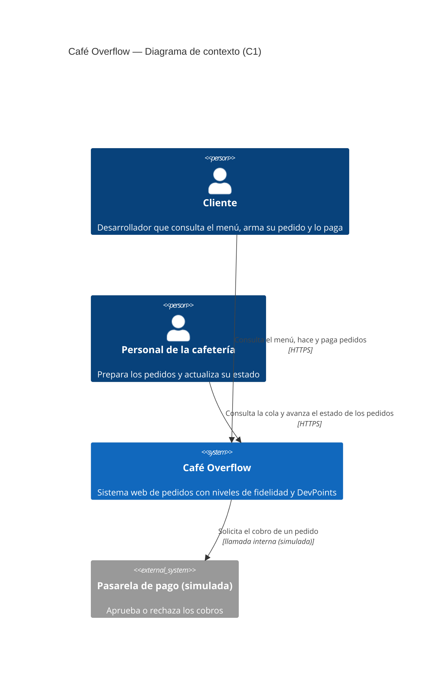

# C1 — Diagrama de contexto

Notas:

- No hay API de inventario: el stock vive en la base de datos del propio sistema.
- La pasarela de pago es simulada (`PasarelaSimulada`, en `negocio/pasarela.py`).
- El personal apunta hacia el sistema (es quien lo usa), igual que el cliente.
