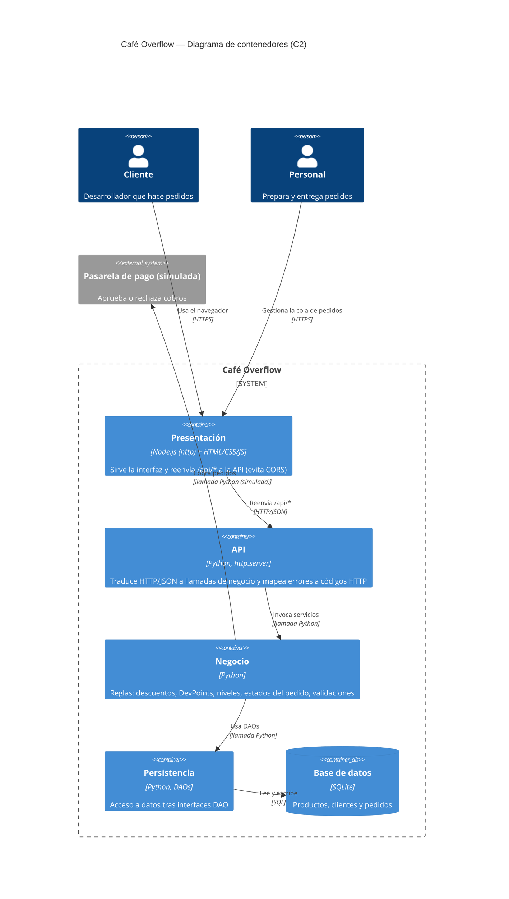

# C2 — Diagrama de contenedores

Notas:

- La base de datos es SQLite (no Redis).
- No hay API de inventario.
- `negocio` define las interfaces DAO y `persistencia` las implementa; `negocio` no contiene SQL, HTML ni JSON.
